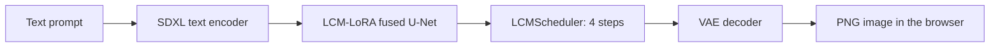

# Text to Image Generation


Generate images from text in about 4 steps. This project pairs **Stable Diffusion XL (SDXL)** with **LCM-LoRA (Latent Consistency Model LoRA)** so a generation that normally needs 50 or more diffusion steps finishes in 4 steps, with a simple Flask web interface on top.

Type a prompt, press Generate, and download the image. No prompt engineering degree required.

## Why this project is interesting

Standard SDXL is high quality but slow: it refines an image over 50 or more small steps. LCM-LoRA teaches the model to take much larger, more confident steps. The result is the same SDXL base model, the same 1024px quality range, but a generation that is roughly an order of magnitude faster in step count.

| | Standard SDXL | SDXL + LCM-LoRA (this project) |
|---|---:|---:|
| Inference steps | 50+ | 4 (default, adjustable 1 to 8) |
| Guidance scale | 5 to 9 | 1.0 (default, LCM works with low guidance) |
| First run download | about 7 GB | about 7 GB, plus a small LoRA adapter |
| Output | 1024 x 1024 | 512, 768, or 1024 (you choose) |

Step counts are the setting used in the code. Wall clock time depends on your GPU.

## How it works



1. **Prompt in.** You type a description in the web UI, optionally with a negative prompt, a seed, a size, and a step count.
2. **SDXL encodes the text.** The `stabilityai/stable-diffusion-xl-base-1.0` model turns the prompt into conditioning for the diffusion model.
3. **LCM-LoRA accelerates sampling.** The `latent-consistency/lcm-lora-sdxl` adapter is fused into the pipeline and the scheduler is swapped to `LCMScheduler`. Instead of 50 small denoising steps, the model converges in 4.
4. **Image out.** The result is saved as a PNG under `static/generated_images/` and shown in the browser with a download button.

Read the longer explanation in [docs/ARCHITECTURE.md](docs/ARCHITECTURE.md).

## Features

* Text to image in 4 steps by default, adjustable in the UI
* Two ways to run it: online (models download from Hugging Face) or offline (models already on disk)
* Seed control, so a good result can be reproduced exactly
* Negative prompt, size, step count, and guidance controls in the UI
* Example prompts built into the UI, one click to try them
* Session history gallery, so earlier generations stay visible
* Download button for every generated image
* `/health` endpoint that reports whether the model is loaded and which device it is on
* Clear errors for missing prompts, out of memory, and model load failures, instead of a silent crash
* CPU fallback if no CUDA GPU is available (much slower, but it runs)

## Project structure

```text
text-to-image-generation/
├── README.md                  # You are here
├── LICENSE                    # MIT
├── requirements.txt           # Python dependencies
├── .env.example               # Every setting you can change, with defaults
├── .gitignore                 # Keeps generated images and model files out of git
├── CONTRIBUTING.md            # How to contribute
├── docs/
│   ├── ARCHITECTURE.md        # How SDXL and LCM-LoRA fit together
│   └── SETUP.md               # Detailed setup, model downloads, troubleshooting
├── examples/
│   └── PROMPTS.md             # Example prompts that work well, grouped by style
├── s4/                        # Online mode: models fetched from Hugging Face
│   ├── README.md
│   ├── app.py                 # Flask app, SDXL + LCM-LoRA, online
│   └── templates/
│       └── index.html         # Web UI
└── s5 (offline)/              # Offline mode: models loaded from local disk
    ├── README.md
    ├── app.py                 # Flask app, SDXL + LCM-LoRA, offline
    └── templates/
        └── index.html         # Web UI
```

Generated images are saved to `s4/static/generated_images/` or `s5 (offline)/static/generated_images/` depending on the mode you run. They are gitignored, so your generations do not bloat the repository.

## Quick start

### Requirements

* Python 3.10 or newer
* A CUDA GPU with 8 GB or more VRAM is recommended for 1024px images. 768px and 512px need less. CPU works, but is much slower.
* About 8 GB of free disk for the model on first run
* PyTorch 2.6.0 with CUDA 12.5, as in the original setup. Newer PyTorch versions may also work, but this combination is the tested one.

### Option A: online mode (recommended for a first run)

The app downloads SDXL and the LCM-LoRA adapter from Hugging Face on first run. The download is about 7 GB and happens once.

```bash
git clone https://github.com/KESHAVAPANDI/text-to-image-generation.git
cd text-to-image-generation
python -m venv venv
source venv/bin/activate        # Windows: venv\Scripts\activate
pip install -r requirements.txt
cd s4
python app.py
```

Open http://127.0.0.1:5000 in your browser.

### Option B: offline mode

Use this when the models are already on disk, or the machine has no internet access at run time. Download the models once, point the app at them, and it never calls Hugging Face again.

1. Download the SDXL base model and the LCM-LoRA adapter. See [docs/SETUP.md](docs/SETUP.md) for the exact links and folder layout.
2. Set the paths. Either edit the defaults in `s5 (offline)/app.py`, or set environment variables (recommended):

```bash
export MODEL_PATH="/path/to/your/models/sdxl"
export LORA_PATH="/path/to/your/models/lcm_lora_sdxl"
```

On Windows PowerShell:

```powershell
$env:MODEL_PATH = "C:\Users\kesha\models\sdxl"
$env:LORA_PATH = "C:\Users\kesha\models\lcm_lora_sdxl"
```

3. Run it:

```bash
cd "s5 (offline)"
python app.py
```

Open http://127.0.0.1:5000 in your browser.

## Configuration

Every setting has a sensible default. Change them with environment variables, or copy `.env.example` to `.env` and edit it. The app reads the variables at startup.

| Variable | Default | What it does |
|---|---|---|
| `MODEL_ID` | `stabilityai/stable-diffusion-xl-base-1.0` | Hugging Face model used in online mode |
| `LORA_ID` | `latent-consistency/lcm-lora-sdxl` | LCM-LoRA adapter used in online mode |
| `MODEL_PATH` | `C:\Users\kesha\models\sdxl` | Local SDXL folder, offline mode only |
| `LORA_PATH` | `C:\Users\kesha\models\lcm_lora_sdxl` | Local LoRA folder, offline mode only |
| `DEVICE` | auto (CUDA if available, else CPU) | `cuda` or `cpu` |
| `HOST` | `0.0.0.0` | Host the Flask app binds to |
| `PORT` | `5000` | Port the Flask app listens on |
| `DEFAULT_STEPS` | `4` | Inference steps per generation |
| `DEFAULT_GUIDANCE` | `1.0` | Guidance scale |
| `DEFAULT_WIDTH` | `1024` (online) / `768` (offline) | Default image width |
| `DEFAULT_HEIGHT` | `1024` (online) / `768` (offline) | Default image height |
| `MAX_PROMPT_LENGTH` | `1000` | Longest prompt accepted, in characters |
| `FLASK_DEBUG` | `0` | Set to `1` for Flask debug mode during development |

## API reference

The web UI uses these endpoints. You can call them directly too.

### `GET /`

Serves the web UI.

### `GET /health`

Reports whether the model is ready. Useful for scripts and for checking that a slow first load has finished.

```json
{"status": "ready", "device": "cuda", "model": "stabilityai/stable-diffusion-xl-base-1.0"}
```

While the model is still loading, `status` is `loading`. If loading failed, `status` is `error` and the response includes the error.

### `POST /generate`

Generates one image. Request body is JSON.

```json
{
  "prompt": "A cozy cabin in a snowy forest at dusk, warm lights in the windows",
  "negative_prompt": "blurry, low quality",
  "num_inference_steps": 4,
  "guidance_scale": 1.0,
  "width": 1024,
  "height": 1024,
  "seed": 42
}
```

Only `prompt` is required. `seed` is optional: omit it, or send `-1`, for a random seed. The response includes the image URL plus the settings that were actually used, so a result can be reproduced.

```json
{
  "image_url": "/static/generated_images/5159e98a09cf4c5a97d0c4fd7c680610.png",
  "seed": 42,
  "num_inference_steps": 4,
  "guidance_scale": 1.0,
  "width": 1024,
  "height": 1024
}
```

Errors return a JSON object with an `error` field and a suitable HTTP status code: 400 for a missing or invalid prompt, 500 for a generation failure, 503 while the model is still loading.

## Example prompts

A few to start with. The full list, grouped by style, is in [examples/PROMPTS.md](examples/PROMPTS.md).

* "A cozy cabin in a snowy forest at dusk, warm lights in the windows, cinematic lighting"
* "Futuristic city skyline at sunset, flying vehicles, ultra detailed, vibrant colors"
* "Portrait of an astronaut standing on a neon lit alien planet, dramatic rim light"
* "Isometric illustration of a tiny coffee shop on a floating island, soft pastel colors"

Tips that help with SDXL: describe the subject first, then the setting, then the lighting and style. Short, concrete prompts usually beat long, rambling ones. If a result is close but not right, keep the prompt and change only the seed.

## Troubleshooting

| Problem | Likely cause | Fix |
|---|---|---|
| `CUDA out of memory` | Image too large for your VRAM | Use 512 or 768px, or close other GPU apps. The app clears the CUDA cache and reports this instead of crashing. |
| First run is very slow | The model is downloading, about 7 GB | Wait for "Model loaded successfully!" in the terminal. It only downloads once. |
| `Model not found` in offline mode | `MODEL_PATH` or `LORA_PATH` is wrong | Check the folder contains the model files, and that the path in your environment variable matches. See [docs/SETUP.md](docs/SETUP.md). |
| Images look washed out | Guidance too low, or too few steps | Try guidance 1.5 to 2.0 and 6 to 8 steps. |
| `torch` import error | PyTorch not installed, or wrong CUDA build | Reinstall PyTorch 2.6.0 with CUDA 12.5 for your platform, then reinstall the other requirements. |
| Port 5000 already in use | Another app is using the port | Set `PORT=5001` and restart, or stop the other app. |
| It works on CPU but is very slow | No CUDA GPU detected | That is expected. CPU generation is minutes per image. Use a CUDA GPU for real use. |

More detail, including the exact model download steps, is in [docs/SETUP.md](docs/SETUP.md).

## Roadmap

* [ ] Batch generation: several images from one prompt, different seeds
* [ ] Image to image mode: start from an uploaded picture instead of noise
* [ ] Prompt history saved across restarts, not just the current session
* [ ] A Dockerfile, so the app runs without a local Python setup
* [ ] Optional refiner pass for extra detail on 1024px images
* [ ] A simple queue, so the UI stays responsive while a generation is running

Suggestions are welcome. Open an issue, or see [CONTRIBUTING.md](CONTRIBUTING.md).

## Contributing

Contributions are welcome. Please read [CONTRIBUTING.md](CONTRIBUTING.md) first: it covers the setup, the code style, and how to submit a change. Small fixes, better prompts, and documentation improvements are all useful.

## License

MIT. See [LICENSE](LICENSE).

## Acknowledgements

* Stability AI for Stable Diffusion XL
* Hugging Face and the Diffusers team for the pipeline, scheduler, and model hosting
* The Latent Consistency Models authors, whose LCM-LoRA adapter makes the 4 step generation possible

## Author

**Keshava Pandi A S**, AI/ML Engineer, Computer Vision, Generative AI

* GitHub: https://github.com/KESHAVAPANDI
* LinkedIn: https://www.linkedin.com/in/keshava-pandi-a-s-a30108377/
