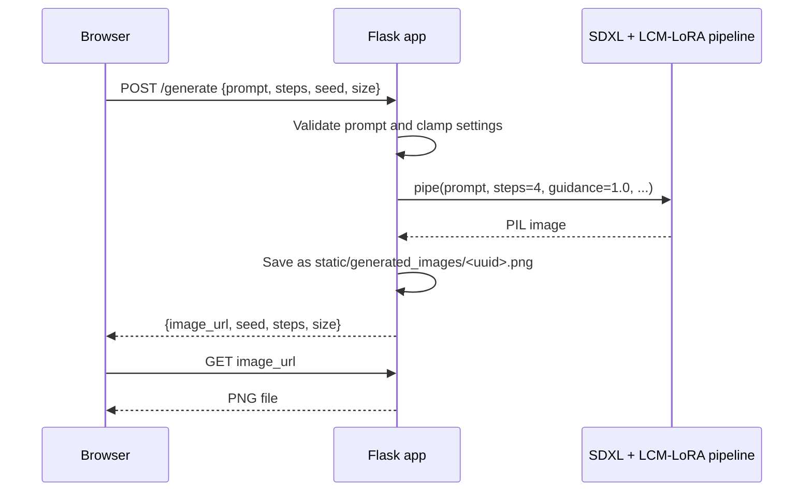

# Architecture

This document explains how the pieces fit together, for anyone reading the code for the first time.

## The idea in one paragraph

Stable Diffusion XL generates an image by starting from noise and removing a little noise at a time, guided by a text prompt. Normally that takes 50 or more steps. Latent Consistency Models (LCM) distil that slow, many step process into a model that can jump to a clean image in very few steps. LCM-LoRA is that idea packaged as a small LoRA adapter: it plugs into an existing SDXL model, it does not replace it, and it can be fused into the weights at load time. This project loads SDXL, fuses the LCM-LoRA adapter, swaps the scheduler to `LCMScheduler`, and then generates in 4 steps.

## Components

### SDXL base model

`stabilityai/stable-diffusion-xl-base-1.0`, loaded in float16.

* Text encoders turn the prompt into conditioning vectors.
* The U-Net does the denoising, conditioned on those vectors.
* The VAE decodes the final latent image into pixels.

SDXL is natively a 1024 x 1024 model. Smaller sizes (512, 768) also work and need less VRAM.

### LCM-LoRA adapter

`latent-consistency/lcm-lora-sdxl`, loaded with `pipe.load_lora_weights()` and then fused with `pipe.fuse_lora()`.

Fusing bakes the adapter into the U-Net weights, so there is no extra cost at generation time. After fusing, the pipeline behaves like a fast SDXL, not like SDXL plus a plugin.

Key consequence: guidance scale should stay low, around 1.0. LCM models were trained to work with little or no classifier free guidance. High guidance (5 or more, normal for SDXL) usually makes LCM output worse, not better.

### Scheduler

`LCMScheduler`, created from the pipeline's existing scheduler config:

```python
pipe.scheduler = LCMScheduler.from_config(pipe.scheduler.config)
```

The scheduler decides how much noise to remove at each step. The LCM scheduler is designed for the large jumps the LCM adapter makes, which is why the step count can drop from 50 to 4.

### Flask web app

One file, `app.py`, per mode. It does three things:

1. Loads the model once at startup, so the web UI is fast after the first load.
2. Serves the UI at `GET /` and a readiness check at `GET /health`.
3. Handles `POST /generate`: validates the prompt and settings, runs the pipeline, saves the PNG with a random filename, and returns its URL plus the settings used.

There is no database and no user accounts. Generated images live on disk under `static/generated_images/` and are served as static files.

## The two modes

Both modes run the same pipeline. They differ only in where the model comes from.

| | Online (`s4`) | Offline (`s5 (offline)`) |
|---|---|---|
| Model source | Hugging Face, downloaded on first run | Local folders on disk |
| Internet needed | Yes, on first run | No, after the one time download |
| Model setting | `MODEL_ID` and `LORA_ID` | `MODEL_PATH` and `LORA_PATH` |
| Default size | 1024 x 1024 | 768 x 768, lower VRAM use |
| Extra behaviour | None | `torch.backends.cudnn.benchmark = True`, explicit out of memory handling |

The folder names `s4` and `s5` are kept from the original project history. If you are starting fresh, use online mode first.

## Request flow



## Settings and what they do

* **Steps (1 to 8, default 4).** More steps add a little detail and cost a little time. Above 8, LCM gains almost nothing.
* **Guidance scale (0 to 7, default 1.0).** How strongly the prompt is followed. LCM works best near 1.0 to 2.0.
* **Seed.** The random starting noise. Same prompt, same seed, same settings, same image. Change only the seed to get variations of the same prompt.
* **Negative prompt.** Things to avoid, for example "blurry, low quality". It is passed to the pipeline as `negative_prompt`.
* **Size.** Width and height, each a multiple of 8. 1024 is sharpest, 512 is fastest and needs the least VRAM.

## Memory

* The model is loaded in float16, which halves the memory compared to float32.
* On CUDA, the pipeline is moved to the GPU with `pipe.to("cuda")`.
* Offline mode enables `cudnn.benchmark`, which lets cuDNN pick the fastest convolution for the fixed input sizes used here.
* If generation runs out of VRAM, the app catches `torch.cuda.OutOfMemoryError`, clears the CUDA cache, and returns a clear error instead of crashing the server.

## Limitations, stated plainly

* This is a demo app, not a production service. One generation runs at a time, there is no queue, and Flask runs in debug mode only when you explicitly enable it.
* The model runs locally, so speed depends entirely on your GPU. CPU generation works, but is minutes per image.
* LCM trades a small amount of fine detail for speed. For maximum detail on a single image, a standard 50 step SDXL run, or a refiner pass, will still beat it.
* Generated images reflect the training data of SDXL. Prompts that ask for real people, or for disallowed content, are not a use case for this project.
